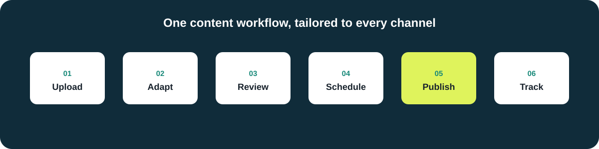

# OmniPost

OmniPost is a semester-scale MVP for preparing and scheduling social content across Instagram, TikTok, and X. A creator adds media and source notes once, reviews a caption tailored to each platform, then schedules or publishes each version from one workspace.



## What works

- User registration, sign-in, salted password hashing, and server-side sessions
- Validated video or image upload with configurable size limits
- Platform-specific caption and hashtag adaptation
- Per-platform review and editing
- Scheduled posting through a separate worker
- Modular connectors for Instagram, TikTok, and X
- Safe demo publishing with deterministic external IDs
- Publishing status, history, upcoming queue, and platform summaries
- OpenAPI documentation and end-to-end API tests
- Responsive Next.js interface and Docker Compose setup

## Why publishing uses demo connectors

Social networks require developer accounts, OAuth credentials, permission review, and eligible account types. Those credentials must never enter a public repository. The included connectors implement the complete publishing boundary without external side effects. They make the application fully demonstrable and provide a clear interface for approved production integrations.

## Quick start with Docker

Requirements: Docker Desktop with Docker Compose.

```bash
git clone https://github.com/suyoscar11/Junior-Seminar.git
cd Junior-Seminar
docker compose up --build
```

Open:

- Web app: <http://localhost:3000>
- API documentation: <http://localhost:8000/docs>

Create an account in the web app. Add a title and transcript, optionally attach supported media, and generate the platform versions. The worker checks scheduled posts every 15 seconds.

Stop the application with `docker compose down`. Add `-v` only if you also want to remove the local Docker volume and its demo data.

## Local development

Requirements: Python 3.11+, [uv](https://docs.astral.sh/uv/), Node.js 22+, and npm.

Terminal 1:

```bash
make dev-api
```

Terminal 2:

```bash
make dev-worker
```

Terminal 3:

```bash
cd frontend
npm install
npm run dev
```

The backend creates `data/omnipost.db` and `data/uploads/` automatically. Configuration examples live in `.env.example`.

## Verification

```bash
make test
make build
```

GitHub Actions runs both checks on every push and pull request.

## Project structure

```text
backend/                 FastAPI application, worker, and tests
frontend/                Next.js and TypeScript interface
data/                    Local database and media during development
docs/                    Architecture and API documentation
.github/workflows/       Continuous integration
docker-compose.yml       Reproducible three-service environment
```

## Architecture

The browser calls a FastAPI service for accounts, media, content, posts, and dashboard data. SQLite provides a zero-configuration demonstration database. A separate worker processes scheduled posts through the same connector interface used by immediate publishing. See [docs/ARCHITECTURE.md](docs/ARCHITECTURE.md) for tradeoffs and the production roadmap.

## Known limitations

- Demo connectors do not call social network APIs.
- Caption adaptation uses a deterministic local algorithm, so the app runs without a paid AI key.
- Analytics show stored metrics and publishing status. Live engagement ingestion requires approved platform APIs.
- Uploaded media persists locally or in the Docker volume. Production deployments should use S3 or R2.

## Academic project

Created by Suyog Gaire for Junior Seminar. The original proposal and final presentation are included in this repository for assessment and reproduction.

